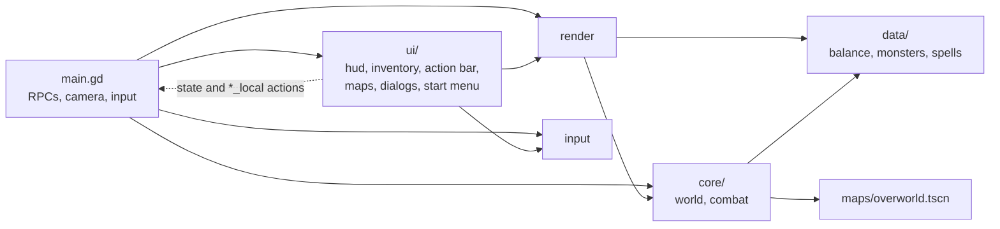

# Architecture

## Repository layout

```text
project.godot            Godot project; the entry scene is game/main.tscn
Makefile                 Developer commands (`make help`)
game/
  main.tscn, main.gd     Entry scene: ENet lifecycle, RPC endpoint (/root/Main), camera, input; assembles the UI
  core/                  Server-authoritative simulation shared by every peer (no nodes)
    world.gd             Map loading, item catalog, movement, inventory and depot, packs, bag slots, travel
    combat.gd            Targeting, attacks, spells, monster AI, death, skulls, parties, loot, tasks, potions
    economy.gd           Vendors (stock, buying, selling) and the banker (gold accounts)
    crafting.gd          Professions on the host: herb patches, gathering (nodes, regrowth), crafting at artisans, skill training
    instances.gd         Instanced dungeon copies: entry, party ownership, exits, and resets
    lexicon.gd           Monster lexicon: levels, places, tasks, and drop tables from the catalogs
    bots.gd              Host player bots: hunter, PvP, dummy, companion, and rival stances through the real rules
    bot_loot.gd          Bots collect the loot their group earned (Combat.loot_claims) and sell it at vendors
    solo.gd              Solo play: companions around your class, rival bands, PvP ambushes, raid fill and disband
    nav.gd               Long-range bot navigation: AStarGrid2D over the walkable overworld
    ai/                  LimboAI behavior tree for bots: bot_tree.gd (builder), bot_agent.gd, tasks/
  data/                  Static catalogs and curves
    balance.gd           Level 1-50 curves, vocations, stats
    items.json           Item catalog (also read by the sprite generator)
    items.gd             Loads items.json; derives tier and relic stats and vendor prices
    quests.gd            Town, hub, and dungeon tasks, their givers and rewards, relic keepers, trainers
    dungeons.gd          Instanced dungeon layouts, copies, levels, and monsters
    caves.gd             Shared elite caves: areas, levels, camps, and champions
    bot_behavior.tres    The bots' LimboAI behavior tree (edit in the editor's LimboAI tab; `make bot-tree` rebuilds it)
    biomes.gd            Climate regions (the desert: no rain, cactus scrub)
    regions.gd           Named overworld regions (anchors and descriptions; levels derived)
    buildings.gd         Finds buildings (rooms, doors, roof footprints) from walls
    monsters.gd          Monster catalog, loot tables, bosses and their relics
    spells.gd            Spell catalog and cooldown groups
    professions.gd       Gathering and crafting skills, resource bands, skill curve, recipe derivation, food
  persistence/           Host-side saves and the client identity
    character_store.gd   Signed per-character save files; capture, restore, and sanitizing
    identity.gd          This computer's secret identity token (user://identity.cfg)
  input/keybinds.gd      Rebindable keys and the spells-only action bar
  ui/                    UI components; each gets the main node and builds controls into its UI layer
    layout.gd            Shared screen layout constants (game window, panel origin, zoom, bar slot)
    game_window.gd       Game window: world SubViewport, rain, vignette, overlay; forwards map input to main
    hud.gd               Title row (Controls, Leave game), status line, action message, zone banner, vitals, Controls menu
    inventory_panel.gd   Paperdoll, backpack, and bag slots, bag windows, drag-and-drop, stat sheet, item tooltips
    quest_list.gd        Quest list in the game window: active tasks, givers, progress
    spell_book.gd        Spell book (B): your vocation's spells explained (Spells.info), drag to the bar
    character_window.gd  Character window (C): stats explained, experience, and status (meal included)
    professions_window.gd Professions window (P): each skill's level, progress, and what it gathers or crafts
    party_window.gd      Party window (O): members' class, level, and health, invitations, Leave party, solo raid
    lexicon_window.gd    Lexicon (K): searchable monster list with drop tables
    ui_theme.gd          The dark-and-gold button and field look (start screen, top bar)
    micro_menu.gd        Buttons right of the action bar for the character, book, professions, quests, map, controls
    spell_rune.gd        A spell rune: drawing, coloured tooltip, drag and drop (bar and book)
    item_slot.gd         An item slot whose hover tooltip shows the rarity colour
    action_bar.gd        Nine-slot spell bar, its spell menu, and filling slots for a vocation (again after a trainer)
    world_maps.gd        Minimap and world map drawn from one terrain texture
    npc_dialogs.gd       NPC service menu; travel, trade, bank (depot), quest, runes, and craft dialogs; player party menu
    start_panel.gd       Start screen until you play: painted backdrop, character list and creation, play solo, host, or join
    controls_menu.gd     Key-binding window
  render/                Client-side drawing only
    floor_layer.gd       Floors drawn once into cached 16x16-tile chunks (one chunk per frame)
    water.gdshader       Animated water and pier chunks, no redraw needed
    world_view.gd        Depth-ordered walls, trees, NPCs, items and actors (sparse, cached)
    world_overlay.gd     Unlit layer: nameplates, NPC names, target square, floating numbers
    lighting.gd          Day/night, zone ambient, and weather tint (CanvasModulate), pooled point lights
    weather.gd           Deterministic weather from the host clock (clear/overcast/rain/storm, lightning)
    roof_art.gd          Pitched building roofs rasterized from material swatches
    cell_index.gd        Chunked spatial index: monsters and ground stacks near the camera
    rain_layer.gd        Rain over the game window (rain.gdshader: drops, splashes, veil)
    fx.gd                One-shot particle bursts (CC0 Kenney textures)
    glow_layer.gd        Additive pass: relic and boss halos, sparks
    vignette.gdshader    Soft dark edge around the game window
    sprite_art.gd        Sprite-sheet regions and character layers
  maps/
    overworld.tscn       The world, painted in Godot's TileMap editor
    terrain.tres         Editor tile set (terrain custom data)
    markers/             Inspector scripts for spawn, item, ferryman, quest giver, townsfolk, dungeon entrance, zone, monster markers
assets/sprites/          Original generated sprite sheets, imported painted outfits/ and icons/ (+ Godot .import files)
art/outfits/             Painted outfit sources and manifest.json (imported by make outfits)
assets/third_party/      CC0 textures with their licenses (CREDITS.md)
tests/
  unit/                  Deterministic rule checks (no networking, no rendering)
  integration/           Real ENet peers and the two-bot playthrough
  visual/                Offscreen rendering checks
tools/
  generators/            make_sprites.py, import_outfits.gd, make_map.gd, endgame_zone.gd, dungeons.gd, caves.gd, desert.gd, swamp.gd, town_paths.gd, towns.gd, balance_table.gd, gear_table.gd
  testing/               Python runners that supervise Godot processes and write reports; lint.gd, fight_sim.gd, duel_sim.gd, bench.gd
docs/                    Gameplay, world editing, art, balance, testing, this file
.tools/                  Ignored: test reports, captures, downloads
```

Dependencies point one way: `render/`, `ui/`, and `input/` may use `core/` and `data/`,
and `ui/` also uses `render/` (sprite drawing, the world view) and `input/` (key bindings);
`core/` uses `data/` but never nodes, rendering, or input; `data/` depends on nothing
else in the game. `main.gd` wires them together: UI components hold an untyped reference
to the main node, read its replicated state (`actors`, `self_id`, `ground_view`), and send
actions through its `*_local` functions, never through RPCs of their own.



## Authority and networking

`game/core/world.gd` loads the map scene (terrain, spawns, items, ferrymen, zones, monster
spawns) and owns the item catalog and authoritative movement, inventory, and travel rules.
`game/core/combat.gd` runs targeting, attacks, spells, monster AI, deaths, experience, loot,
and respawns on the host; `game/data/monsters.gd` and `game/data/spells.gd` are their catalogs. `game/main.gd` handles ENet,
sender-validated RPCs, the camera, input, and interpolation, and assembles the UI components in
`game/ui/` (inventory panel and drag-and-drop, action bar, NPC menus and dialogs, minimap and
world map, HUD, start menu).
`game/render/world_view.gd` draws the visible, depth-ordered part of the world and `game/render/sprite_art.gd` maps tiles, walls, characters, gear, and icons to
sprite-sheet regions. Floors are not redrawn per frame: `floor_layer.gd` draws each
16x16-tile chunk once (visible chunks first, at most one per frame, far chunks freed), and
water is a separate chunk animated by `water.gdshader`. `world_view.gd` caches the walls,
trees, and NPCs around the view and each frame visits only cells with content, sorted by
depth. On the host, monster steps share one occupied-tile set per tick
(`World.occupied_cells`) and monsters sleep at home unless a player is in a nearby 16-tile chunk.
Instanced dungeon copies live outside `World.OVERWORLD`; `game/core/instances.gd` assigns a
party a copy, spawns its monsters only then, and resets it after it has been empty for 60 s.
Clients receive monsters and combat effects only within 24 tiles in the same space (the
overworld or the same copy); `main.gd` tracks what each peer knows and sends arrivals and
departures every 0.25 s. Backpack and ground entries are strings: an item id, or
`"id#count"` for a stack (`World.kind_of`, `World.count_of`, `World.make_entry`).
Peer 1 keeps gameplay authority; clients request actions,
never positions, item contents, or appearance.
Characters persist on the host only: `game/persistence/character_store.gd` saves each player as
signed JSON (HMAC-SHA256 with a per-host key) named after the SHA-256 of the client's identity
token (`game/persistence/identity.gd`, sent in the `hello` handshake), and sanitizes every
loaded field against the catalog. `main.gd` admits a joining identity once, restores its save
(or creates and saves a new character), and saves on leave, every 30 s, and when the host
quits.
The connection handshake checks matching map scene, catalog, ground items, inventory
and movement parameters, player capacity, and protocol. Command-line startup exits nonzero if hosting
cannot bind its UDP port or the supplied join address is empty.

## Conventions

- `game/data/items.json` is read at runtime with `FileAccess`; an exported build must
  include `*.json` in its export filter.
- Typed GDScript, tabs, snake_case files; `preload("res://...")` with full paths
  (no `class_name` globals). Keep `.uid` files next to their scripts and commit them.
- Moving a file: use `git mv` for the file and its `.uid`, update `res://` paths, then run
  `make import` and `make test`.
- New gameplay rules go in `core/` with checks in `tests/unit/`; anything that crosses
  the network also gets a scenario in `tests/integration/peer_test.gd`.
- Generated content (`assets/sprites`, the first map draft) has its generator in
  `tools/generators/`; once a file is hand-edited, it is the source of truth.
- `make lint` must pass: warnings in `project.godot` (unused, shadowing, unreachable, narrowing)
  are errors. Never name locals `name`, `owner`, `visible`, `root`, or after a member function.

## Performance and memory

The host holds every monster (about 1,800) and every ground stack, so per-frame and per-tick
code must not scan them all:

- Rendering asks `main.monsters_in(area)` and `main.ground_in(area)` (chunked
  `game/render/cell_index.gd`) for what is near the camera; keep the index current when adding
  ways to create or remove monsters or ground stacks on the client.
- `World.terrain` reads a byte grid (`World.GRID`); `ROWS` is for whole-row passes.
- Monster steps use `Combat._occupancy`, built once per tick and updated as monsters move;
  invalidate it (`_taken_at = NAN`) when monsters are created or removed.
- Static per-cell drawing is cached (tall objects per view area, floors per chunk, roofs per
  building); rebuild caches on area change, never per frame.
- Pools are bounded: point lights are reused in request order (`Lighting.MAX_LIGHTS`),
  particle bursts are capped (`Fx.MAX_BURSTS`) and free themselves, effects expire after a
  second.
- Long-lived dictionaries keyed by players, peers, monsters, or cells must have a removal
  path: peer data is dropped on disconnect, monster fight records die with the monster or its
  reset, aggressor entries are pruned when they expire, and ground stacks decay
  (`World.decay_ground`). `make soak` checks that nothing keeps growing.
- The client slides only the monsters that are still between tiles (`main._moving_monsters`);
  one standing still costs nothing per frame.
- Bots take their turns at their own moment in each `Bots.THINK_SECONDS`
  (`Bots.think_phase`), so twenty raid bots never all think in the same frame.

**Measuring.** `make bench` plays solo offscreen without vsync through three scenes and
prints the frame time and where it goes (`main.frame_profile`, opt-in per frame section):

| Scene | Before (avg / worst) | After (avg / worst) |
| --- | --- | --- |
| Town: you, companions, two rival bands | 4.9 ms / 17.8 ms | 3.5 ms / 8.5 ms |
| Hunt: your group at an outlaw camp | 4.9 ms / 20.1 ms | 3.5 ms / 12.9 ms |
| Raid: twenty players at level 50 | 5.9 ms / 31.0 ms | 4.4 ms / 9.3 ms |

The choppiness was spikes, not the average: every bot thought in the same frame (up to 23 ms
of bot work at once in a raid), and the client re-slid all 1,800 monsters every frame (1.3 ms).
What is left in the worst frames is path search (`Combat.path_step`, up to 900 cells when a
goal cannot be reached) and the combat tick every 0.1 s.
