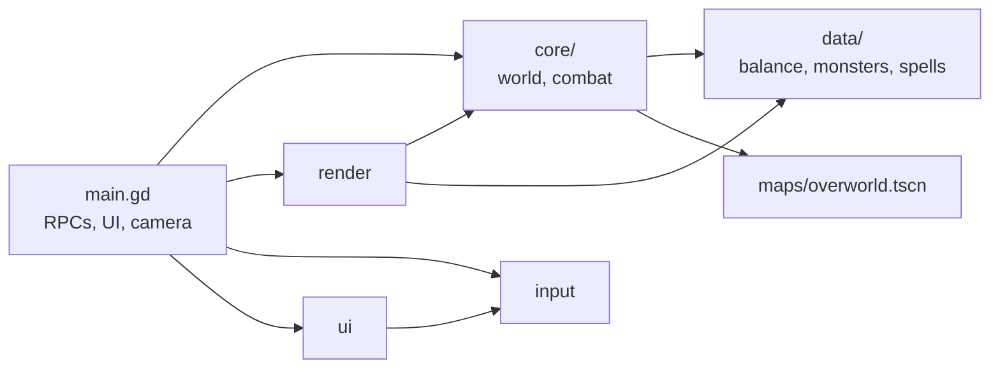

# Architecture

## Repository layout

```text
project.godot            Godot project; the entry scene is game/main.tscn
Makefile                 Developer commands (`make help`)
game/
  main.tscn, main.gd     Entry scene: ENet lifecycle, RPC endpoint (/root/Main), UI, camera, input
  core/                  Server-authoritative simulation shared by every peer (no nodes)
    world.gd             Map loading, item catalog, movement, inventory, travel
    combat.gd            Targeting, attacks, spells, monster AI, death, skulls, parties, loot
  data/                  Static catalogs and curves
    balance.gd           Level 1-50 curves, vocations, stats
    monsters.gd          Monster catalog and loot tables
    spells.gd            Spell catalog and cooldown groups
  input/keybinds.gd      Rebindable keys and the spells-only action bar
  ui/controls_menu.gd    Key-binding window
  render/                Client-side drawing only
    world_view.gd        Depth-ordered world, nameplates, effects
    sprite_art.gd        Sprite-sheet regions and character layers
  maps/
    overworld.tscn       The world, painted in Godot's TileMap editor
    terrain.tres         Editor tile set (terrain custom data)
    markers/             Inspector scripts for spawn, item, ferryman, zone, monster markers
assets/sprites/          Original generated sprite sheets (+ Godot .import files)
tests/
  unit/                  Deterministic rule checks (no networking, no rendering)
  integration/           Real ENet peers and the two-bot playthrough
  visual/                Offscreen rendering checks
tools/
  generators/            make_sprites.py, make_map.gd, balance_table.gd
  testing/               Python runners that supervise Godot processes and write reports
docs/                    Gameplay, world editing, art, balance, testing, this file
.tools/                  Ignored: test reports, captures, downloads
```

Dependencies point one way: `render/`, `ui/`, and `input/` may use `core/` and `data/`;
`core/` uses `data/` but never nodes, rendering, or input; `data/` depends on nothing
else in the game. `main.gd` wires them together.



## Authority and networking

`game/core/world.gd` loads the map scene (terrain, spawns, items, ferrymen, zones, monster
spawns) and owns the item catalog and authoritative movement, inventory, and travel rules.
`game/core/combat.gd` runs targeting, attacks, spells, monster AI, deaths, experience, loot,
and respawns on the host; `game/data/monsters.gd` and `game/data/spells.gd` are their catalogs. `game/main.gd` handles ENet,
sender-validated RPCs, host/join UI, the camera, the inventory panel,
drag-and-drop, the ferry menu, the minimap and world map, and interpolation.
`game/render/world_view.gd` draws the visible, depth-ordered part of the world and `game/render/sprite_art.gd` maps tiles, walls, characters, gear, and icons to
sprite-sheet regions. Peer 1 keeps gameplay authority; clients request actions,
never positions, item contents, or appearance.
The connection handshake checks matching map scene, catalog, ground items, inventory
and movement parameters, player capacity, and protocol. Command-line startup exits nonzero if hosting
cannot bind its UDP port or the supplied join address is empty.

## Conventions

- Typed GDScript, tabs, snake_case files; `preload("res://...")` with full paths
  (no `class_name` globals). Keep `.uid` files next to their scripts and commit them.
- Moving a file: use `git mv` for the file and its `.uid`, update `res://` paths, then run
  `make import` and `make test`.
- New gameplay rules go in `core/` with checks in `tests/unit/`; anything that crosses
  the network also gets a scenario in `tests/integration/peer_test.gd`.
- Generated content (`assets/sprites`, the first map draft) has its generator in
  `tools/generators/`; once a file is hand-edited, it is the source of truth.
