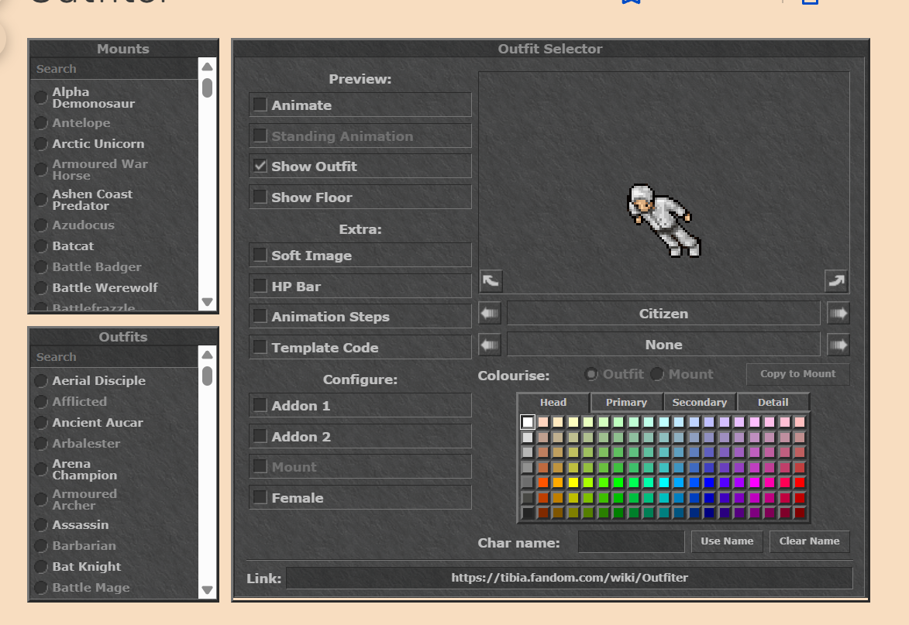

TODO LIST:

Each open item has an implementation plan in docs/plan/ (see docs/plan/README.md for the order). Remove an item here when its plan is done.

lets look at adding a sound engine for better immersion of weather and attacks , mobs etc. (plan 20)

lets add some smaller mini bosses as rare creatures from levels 10-50 anywhere in the world that only attack if you attack them, the theme of these should be like Tibias Sword of Fury, , mino mage, Serpentine Tower, Paradoxica motsvarigheter, this is a later thing we can do when we have the game in a good and ready state. (plan 21)

Outfits from quests, later thing (plan 22)

the lanterns flicker when you go near them, lets address this 

we should redesign the map to have 1 major city per continent and 1 smaller one per continent. (plan 32)

i noticed a lot of the areas are missing the updated art we should align

lets add a buff bar so I can see if I have a active food buff or not, this can also get extended to buff spells that increase power for the party and yourself

lets add a return home rune spell that can be found on monsters above level 30

lets look at adding mounts that increase movement speed 

we need more spells variety for each 10th level bracket, lets brainstorm on this of what spells could be added, or if we should just make endgame spells rune based so the really high damage spells comes from runes

lets update the char models, https://tibia.fandom.com/wiki/Outfiter , the outfitter shows the perfect example of the direction of art we want. 

check where we are missing the new art style compared to the old, there is a lot of mismatching around the world (plan 38)
